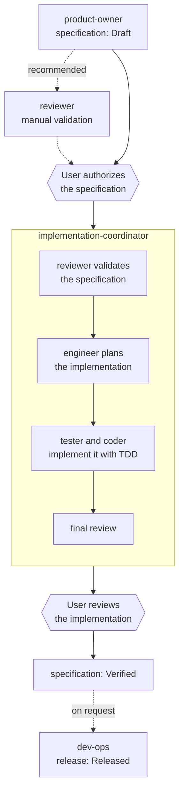
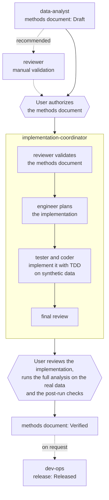

# AI_agents

Agent definitions for programming with AI, usable from Codex and Claude Code.

## Contents

- `.agents/`: the neutral agent sources (`agents/`), shared skills (`skills/`), references
  (`references/`, including the phase reference `phases/`, the shared templates `templates/`, and
  the framework principles), the framework configuration (`config/`, with the model of each
  agent profile in `model-profiles.md`), the agent generator (`scripts/generate_agents.py`), and
  the version marker (`VERSION`) with its `CHANGELOG.md`. The `AGENTS.md` template lives in the
  `project-bootstrap` skill.
- `.codex/`: Codex configuration and the 12 custom agents (`agents/*.toml`), generated from
  `.agents/agents`.
- `.claude/`: Claude Code settings and the agents (`agents/*.md`), generated from
  `.agents/agents`. `.claude/skills` is a symbolic link to `.agents/skills`.
- `docs/`: the [programming workflow](docs/programming-workflow.md), the
  [analysis workflow](docs/analysis-workflow.md), and the generated [catalog](docs/catalog.md) of
  agents, skills, templates and references. It is not installed in projects.
- `AGENTS.md`, and `CLAUDE.md`, which imports it: the instructions for agents that work on this
  repository. They are repository-only and not installed in projects.

The definitions are kept in one piece. They include Nextflow, Groovy and nf-core profiles and
skills (`writing-code`, `linting`, `planning-specs`, `generating-specs`, `testing-unit`,
`nfcore-component-reuse`, `importing-nf-core`), and the analysis workflow (`data-analyst`, the
analysis methods template, the input data reference `.agents/references/analysis-inputs.md`, the
`defining-analysis-inputs`, `planning-analysis`, `selecting-container-images` and
`building-container-images` skills, and the `analysis.md` profiles), plus general R, R Markdown,
Python and Bash coding guidelines usable by any workflow. Language and framework profiles live in
each skill's `references/` folder; remove the ones a target project does not need.

## Workflows

The agents support two workflows: one for programming and one for data analysis. In both, a
person approves a contract, a specification or an analysis methods document, and
`implementation-coordinator` executes it with the same agents (`engineer`, `tester`, `coder`,
`cleaner`, `reviewer`, `dev-ops`) and the same rules:

- A person approves the exact contract before any code is written. Agents never infer approval.
- After the user's authorization, `reviewer` validates the contract read-only. Only a contract
  without blocking findings receives a task branch and the approval commit; otherwise it stays at
  `Draft`, no branch is created, and the findings go back to the user.
- `engineer` turns the approved contract into one implementation plan, which declares every
  phase to run, including the final ones. The coordinator commits the plan before running it.
- Each phase is defined once, in `.agents/references/phases/`, with its steps, the skill it uses,
  the evidence it returns and its stops. The coordinator passes that definition unchanged to the
  agent that runs the phase, with the `agent-delegation` skill.
- The coordinator runs as the main session, owns one task branch and commits only green work. It
  never pushes, merges or tags; those are separate requests.
- Work advances in small steps or increments, each with a failing test first (RED), then the
  code that makes it pass (GREEN).
- Every document has one file that is revised in place, and its status records where the work
  stands: `Draft` → `Approved` → `Planned` → `Coded` → `Verified` → `Released`.
- When a delegate finds an ambiguity, missing data or a blocking review finding, the coordinator
  stops, records it in the implementation plan's Blockers and reports it instead of guessing.

Validating the contract yourself before authorizing it is recommended, because it shows the
findings while the document is still being written. Run `reviewer` as the main session with the
contract's path:

```bash
claude --agent reviewer <path to the specification or methods document>
```

It explains each finding in plain language, with the affected section, and ends with a verdict.
Validation does not approve the contract; your authorization to `implementation-coordinator` does.

### Programming workflow

`product-owner` writes a specification with testable acceptance criteria, optionally from a PRD
by `analyst` and an ADD by `architect`. `engineer` plans it as ordered steps; each step runs
`tester: test` (RED), `coder: implementation` (GREEN) and `cleaner: refactor`, or a direct or
Nextflow-specific phase when the plan says why. A full validation and an independent
implementation review close the work before the user's review. The figure summarizes the steps
that the user sees; the detailed sequence and its figure are in
[docs/programming-workflow.md](docs/programming-workflow.md).



### Analysis workflow

`data-analyst` writes a methods document with the user, which reads like the methods section of
a paper. `engineer` plans it with container images, synthetic test data rules and formal
acceptance criteria. Agents run every script only on synthetic data and reference subsets, and on
the real data only the input checks; tests check form, never results. The user runs the full
analysis, and agents never interpret results. The figure summarizes the steps that the user
sees; the detailed sequence and its figure are in
[docs/analysis-workflow.md](docs/analysis-workflow.md).



## Requirements

The external tools that the framework itself needs:

| Tool | Used by | When needed | If missing |
| --- | --- | --- | --- |
| Python 3.6 or later | `install.py` and the agent generator | Always | Required |
| Git | `install.py`; task branches and commits | Always | Required |
| Codex or Claude Code | Running the agents and skills | Always | Required |
| Apptainer or Docker | Analysis: every script, test and check runs in a container image, and `building-container-images` builds the tier-4 images. Nextflow: reference implementations run their tools with Apptainer | Analysis projects; Nextflow projects with reference implementations, Apptainer only | Required: no analysis or Nextflow reference implementation can run, and `coder: image-build` stops when the build tool or the build permissions are missing |
| Wave CLI `wave` | `selecting-container-images`, for Seqera Containers images (tier 3) | Optional, in analysis projects | The images that tier 3 would provide fall back to a recipe built in Setup (tier 4) |
| ToolUniverse CLI `tu` | `searching-tooluniverse-catalog`, for `data-analyst` | Optional, when `AGENTS.md` declares its path as `ToolUniverse_CLI` | `data-analyst` designs the methods without the ToolUniverse catalog |
| Nextflow | The Nextflow specification workflow: its nf-tests and `nextflow lint` | Nextflow projects | Required |
| nf-core tools `nf-core` | `nfcore-component-reuse` while planning new processing, `importing-nf-core`, and `linting` of the project's own modules, subworkflows and pipeline | Nextflow projects | `nfcore-component-reuse` and `importing-nf-core` stop; `linting` reports the nf-core checks as unavailable |

Each language's test framework and linter, such as testthat and lintr or pytest and ruff, are not
dependencies of the framework: the project's Tech Stack in `AGENTS.md` declares them, and they are
installed in the images of an analysis project and in the project's own environment otherwise.

## Install in a project

```bash
./install.sh /path/to/target-repository            # install, or update an installed project
./install.sh --dry-run /path/to/target-repository  # only show what would change
```

This repository and the target must be Git repositories with no uncommitted changes in `.agents`,
`.claude` or `.codex`; otherwise the script stops, except that `--dry-run` accepts changes in the
target. It thus installs only committed files, and every change it makes in the target can be
reviewed with `git diff` and reverted with `git checkout`. It copies the three folders as they are,
including the generated agents, the agent sources and the generator, but not `docs/`, and links
`.claude/skills` to `.agents/skills`. When the project already has a `.claude/skills` folder, it
links each missing skill inside it instead, leaves the project's own skills alone, and removes the
links of skills that no longer exist. It records every installed file and its hash in
`.agents/.install-manifest.json`, so running it again updates the project:

- Files changed here and untouched in the target are updated. Files removed here, for example
  after a skill reorganization, are deleted.
- Files changed in both places are overwritten and listed as conflicts; restore the project's
  version with `git checkout -- <file>` if needed. Files changed or deleted only in the target
  are kept as they are.
- Files the manifest does not list, such as the project's own skills, are never touched.
  `.claude/settings.json` and `.codex/config.toml` are installed only when absent.
- `.agents/VERSION` holds the semantic version of these definitions and is always overwritten,
  even when the target changed it. The summary shows the source and installed versions with
  their commit hashes, for example `Source version: 0.9.0 (68f6dfc)`, and warns when the version
  being installed is lower than the installed one. `.agents/CHANGELOG.md` is the changelog of
  AI_agents: it lists every change and the upgrade notes for installed projects. A project
  records its own changes in its root `CHANGELOG.md`, never there.
- It shows a summary and asks before changing anything; `--yes` skips that confirmation.
- A project installed by an older version of the script has no manifest. Every file that differs
  is then overwritten as a conflict, and old files no longer in this repository are listed but
  not deleted.

Then, in the target repository:

1. Generate `AGENTS.md`, the briefing and the changelog with the `project-bootstrap` skill
   (template in `.agents/skills/project-bootstrap/AGENTS.template.md`). It proposes, for each
   language of the Tech Stack, a test framework, a linter and recommended packages, and for R
   Markdown reports an output format, by default `BiocStyle::html_document`; accept, edit or
   decline each. `linting`, `testing-unit` and `selecting-container-images` use the declared
   toolchain. A Nextflow line in the Tech Stack, by default with nf-test and `nextflow lint`,
   makes the project a Nextflow project.
2. Add a `CLAUDE.md` that imports it with `@AGENTS.md`, plus the Claude Code note that skills are
   shared through `.claude/skills`. Run user-facing roles as the main session with
   `claude --agent <name>`; this includes `product-owner`, `data-analyst`,
   `implementation-coordinator`, and `reviewer` for the manual contract validation.
3. Create the folders that `AGENTS.md` declares as `Specs_Folder` and `Plans_Folder`, where the
   lifecycle artifacts are stored; the implementation plans of both workflows go in `Plans_Folder`.
   For the analysis workflow, also define in `AGENTS.md` the Analysis layout keys, among them
   `Analysis_Methods_Folder` for the methods documents, `Analysis_Recipes_Folder` for the versioned
   image recipes, `Analysis_Images_Folder` for the built images, `Analysis_Methods_file` and
   `Analysis_Test_Inputs_Folder`; and the container execution rules: the engine that runs and builds
   images, Apptainer or Docker, how to run a command in an image, when an image is available, and
   the build permissions. Ignore the rendered reports, results, figures, test inputs, built images
   and test run outputs (the `results/` folder of each analysis's tests with the default layout).
   For a Nextflow project, define `Nextflow_Reference_Folder`, by default
   `<Project_Folder>/reference-data/<spec-slug-id>/`, and ignore its `results/` folders.
4. For the analysis workflow, deny Claude Code's `Read` tool on the folders that hold the real
   data and reference resources in the project's `.claude/settings.json`, for example
   `"deny": ["Read(/data/**)"]`, so that file contents do not reach the model by accident.

## Update

Each agent has one neutral source, `.agents/agents/<name>.md`, whose frontmatter declares the
`name`, `description`, model `profile`, reasoning `effort`, the `skills` it may use, the Codex
`sandbox_mode`, and the Claude Code `tools`, as the
[agent template](.agents/references/templates/agents.template.md) shows; its body holds the
instructions. Edit the source, never the generated files, then regenerate the Codex and Claude
Code agents and the catalog:

```bash
python3 .agents/scripts/generate_agents.py          # write the generated files
python3 .agents/scripts/generate_agents.py --check  # only list the files that are out of date
```

Agent names use hyphens everywhere; only the generated Codex agents keep the underscore form in
their `name` field (`implementation_coordinator`), as Codex's own examples do.

`craftsman` makes these changes with the `maintaining-framework` skill, following
`.agents/references/framework-principles.md`. Record each change in the Unreleased section of
`.agents/CHANGELOG.md` as its net change from the last released version, upgrade notes included.
