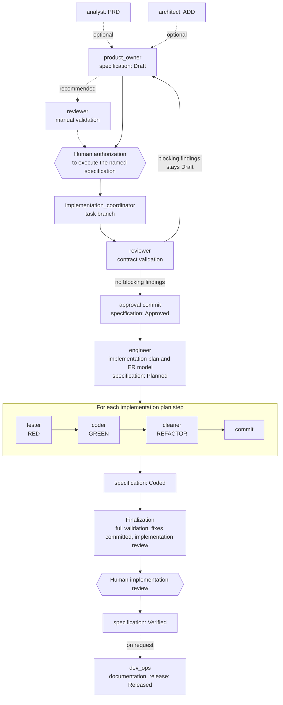
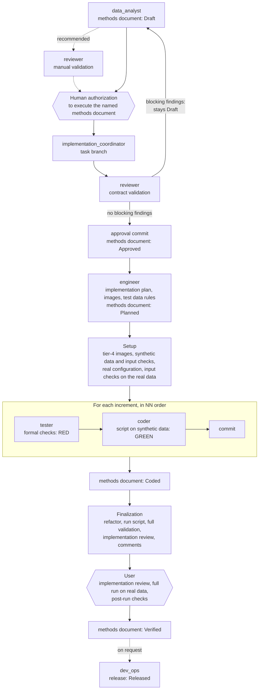

# AI_agents

Agent definitions for programming with AI, usable from Codex and Claude Code.

## Contents

- `.agents/`: shared skills (`skills/`), the workflow catalog (`CODEX.md`), templates
  (`templates/`), references (`references/`), and the version marker (`VERSION`) with its
  `CHANGELOG.md`. The `AGENTS.md` template lives in the `project-bootstrap` skill.
- `.codex/`: Codex configuration and the 12 custom agents (`agents/*.toml`), which are the source
  of truth.
- `.claude/`: Claude Code settings, the agents generated from `.codex/agents`, and
  `scripts/generate_agents.py`. `.claude/skills` is a symbolic link to `.agents/skills`.

The definitions are kept in one piece. They include Nextflow, Groovy and nf-core profiles and
skills (`coding-spec`, `linting`, `planning-specs`, `generating-specs`, `testing-unit`,
`nfcore-component-reuse`, `importing-nf-core`), and the analysis workflow (`data_analyst`, the
analysis methods template, the input data reference `.agents/references/analysis-inputs.md`, the
`defining-analysis-inputs`, `planning-analysis`, `selecting-container-images` and
`building-container-images` skills, and the `analysis.md` profiles), plus general R, R Markdown,
Python and Bash coding guidelines usable by any workflow. Language and framework profiles live in
each skill's `references/` folder; remove the ones a target project does not need.

## Workflows

The agents support two workflows: one for programming and one for data analysis. In both, a
person approves a contract, a specification or an analysis methods document, and
`implementation_coordinator` executes it with the same agents (`engineer`, `tester`, `coder`,
`cleaner`, `reviewer`, `dev_ops`) and the same rules:

- A person approves the exact contract before any code is written. Agents never infer approval.
- After the user's authorization, `reviewer` validates the contract read-only. Only a contract
  without blocking findings receives the approval commit; otherwise it stays at `Draft` and the
  findings go back to the user.
- `engineer` turns the approved contract into one implementation plan, which declares every
  phase to run, including the final ones.
- The coordinator runs as the main session, owns one task branch and commits only green work. It
  never pushes, merges or tags; those are separate requests.
- Work advances in small increments, each with a failing test first (RED), then the code that
  makes it pass (GREEN).
- Every document has one file that is revised in place, and its status records where the work
  stands: `Draft` → `Approved` → `Planned` → `Coded` → `Verified` → `Released`.
- When a delegate finds an ambiguity, missing data or a blocking review finding, the coordinator
  stops and reports it instead of guessing.

Validating the contract yourself before authorizing it is recommended, because it shows the
findings while the document is still being written. Run `reviewer` as the main session with the
contract's path:

```bash
claude --agent reviewer <path to the specification or methods document>
```

It explains each finding in plain language, with the affected section, and ends with a verdict.
Validation does not approve the contract; your authorization to `implementation_coordinator` does.

### Programming workflow



- **Documents in layers**:
  - The PRD (product) and the ADD (architecture) are optional and describe the whole project.
  - Each work item has one specification with testable acceptance criteria in EARS format.
  - `engineer` turns it into one implementation plan of ordered steps, each with the phases and
    agents that execute it, plus an ER model when persistent data change.
- **Status flow**: each transition belongs to one agent, and none can be skipped.
  `implementation_coordinator` records `Approved` in an approval commit, and later commits must
  leave the specification otherwise unchanged.
- **Increments**: the coordinator runs the phases the implementation plan declares, one after
  another, and commits each step only when its tests pass. In Nextflow projects, existing nf-core
  modules are imported with nf-core tools instead of being rewritten.
- **Closing**: at `Coded`, the Finalization phases run a full validation, with any fixes
  committed, and an independent read-only review against the specification and the
  implementation plan. A blocking finding stops the cycle until a person decides. `Verified` is
  set only when the user approves the implementation review.

### Analysis workflow



- **Two documents**:
  - The methods document holds the scientific decisions and reads like the methods section of a
    paper: the scientific question, the design, one short paragraph per methods step with its
    tool as `package::function` and every non-default value, the results to report, the input
    data, the global parameters, the references and a version control table. `data_analyst`
    writes it with the user, proposing each decision and explaining it in plain language.
  - The implementation plan, written by `engineer`, holds the engineering decisions: increments,
    container images, seeds, expected outputs, formal acceptance criteria, the synthetic data
    rules, and a Software and effective parameters table with the resolved versions. `engineer`
    stops and reports a scientific gap in the methods document instead of filling it.
  - Paths come from the Analysis layout in the project's `AGENTS.md`, and the coding and testing
    conventions from the `analysis.md` profiles.
- **Input data** is defined with fixed fields and a closed vocabulary, from
  `.agents/references/analysis-inputs.md`. The user writes it, or `defining-analysis-inputs`
  helps by interview or, with explicit authorization for each path, by exploring the structure of
  the data. Only summaries of that structure reach the agent's context, never data values.
- **Methods**: `data_analyst` can search the
  [ToolUniverse](https://github.com/mims-harvard/ToolUniverse) catalog to support its proposals,
  when the project declares `ToolUniverse_CLI` in `AGENTS.md`; see its repository for
  installation.
- **Container images** come, in this order, from the project registry, BioContainers, Seqera
  Containers or a recipe. `engineer` selects the first three while planning; `coder` builds a
  recipe image in Setup, after `tester` writes its permanent image check. Recipes are versioned;
  built images are not.
- **Agents never compute on real data**:
  - They run every script on synthetic data with the format of the real data, made by a
    versioned generator, and on deterministic subsets of the real reference resources, inside
    each increment's container image.
  - On the real data they run only the input checks, which report failures without values.
    `run-analysis.sh` runs them again, with the image checks, at the start of every run.
  - The same code runs on the test and real data, through two configuration files.
  - The user runs the full analysis. Its outputs go to folders versioned by the methods
    document's version (`vN`).
- **Tests check form, not results**: output checks cover the files, formats, columns, row counts
  relative to an input, provenance files, report sections and reproducibility. They never check
  statistics or other values.
- **Steps that cannot run on synthetic data** are `post-run` increments. They are checked only
  after the user's full run, which `Verified` requires.
- **Revisions**: a change after an approval reopens the methods document at `Draft` and needs a
  new approval. Each content change adds a row to the document's cumulative version control
  table, whose approved rows never change. The user sets `Version`; agents only suggest a new
  one. A change to how results are computed, such as modifying a methods step, needs a new
  version, which renumbers the increments and reruns everything into empty folders; the methods
  template lists which changes fit within a version.
- **Agents never interpret results or draft conclusions**; reports state only what each table
  or figure shows.

## Install in a project

```bash
./install.sh /path/to/target-repository            # install, or update an installed project
./install.sh --dry-run /path/to/target-repository  # only show what would change
```

The script installs only committed files: it stops if `.agents`, `.claude` or `.codex` have
uncommitted changes in this repository. It copies the three folders as they are, including
`.claude/agents`, and links `.claude/skills` to `.agents/skills`. When the project already has a
`.claude/skills` folder, it links each missing skill inside it instead, leaves the project's own
skills alone, and removes the links of skills that no longer exist. It records every installed
file and its hash in `.agents/.install-manifest.json`, so running it again updates the project:

- The target must be a Git repository with no uncommitted changes in `.agents`, `.claude` or
  `.codex`, so every change can be reviewed with `git diff` and reverted with `git checkout`.
- Files changed here and untouched in the target are updated. Files removed here, for example
  after a skill reorganization, are deleted.
- Files changed in both places are overwritten and listed as conflicts; restore the project's
  version with `git checkout -- <file>` if needed. Files changed or deleted only in the target
  are kept as they are.
- Files the manifest does not list, such as the project's own skills, are never touched.
  `.claude/settings.json` and `.codex/config.toml` are installed only when absent.
- `.agents/VERSION` holds the semantic version of these definitions and is always overwritten,
  even when the target changed it. The summary shows the source and installed versions with
  their commit hashes, for example `Source version: 0.9.0 (68f6dfc)`, and warns when the version
  being installed is lower than the installed one. `.agents/CHANGELOG.md` lists the changes of
  each version and the upgrade notes for installed projects; it is not the project's own
  changelog.
- It shows a summary and asks before changing anything; `--yes` skips that confirmation.
- A project installed by an older version of the script has no manifest. Every file that differs
  is then overwritten as a conflict, and old files no longer in this repository are listed but
  not deleted.

Then, in the target repository:

1. Generate `AGENTS.md`, the briefing and the changelog with the `project-bootstrap` skill
   (template in `.agents/skills/project-bootstrap/AGENTS.template.md`).
2. Add a `CLAUDE.md` that imports it with `@AGENTS.md`, plus the Claude Code notes: agent names use
   hyphens (`product_owner` is `product-owner`), skills are shared through `.claude/skills`, and the
   model equivalence between Codex and Claude Code. Run user-facing roles as the main session
   with `claude --agent <name>`; this includes `product-owner`, `data-analyst`,
   `implementation-coordinator`, and `reviewer` for the manual contract validation.
3. Create `agents_data/specs/` and `agents_data/plans/`, where the lifecycle artifacts are stored;
   the implementation plans of both workflows go in `agents_data/plans/`. For the analysis
   workflow, also define in `AGENTS.md` the `Analysis_*` folders, among them
   `Analysis_Methods_Folder` for the methods documents, `Analysis_Tests_Folder` for the tests,
   `Analysis_Recipes_Folder` for the versioned image recipes and `Analysis_Images_Folder` for the
   built images; the Analysis layout keys, such as `Analysis_Methods_file` and
   `Analysis_Test_Inputs_Folder`; and the container execution rules: the engine that runs and
   builds images, Apptainer or Docker, how to run a command in an image, when an image is
   available, and the build permissions. Ignore the rendered reports, results, figures, test
   inputs, built images and test run outputs (`<Analysis_Tests_Folder>/*/results/` with the
   default layout).
4. For the analysis workflow, deny Claude Code's `Read` tool on the folders that hold the real
   data and reference resources in the project's `.claude/settings.json`, for example
   `"deny": ["Read(/data/**)"]`, so that file contents do not reach the model by accident.

## Update

Change agents in `.codex/agents`, then regenerate the Claude Code copies:

```bash
python3 .claude/scripts/generate_agents.py
```

## Model equivalence

| Codex | Claude Code |
| --- | --- |
| `gpt-6-sol` | `claude-opus-5-5` |
| `gpt-5.6-terra` | `claude-sonnet-5-5` |
| `gpt-6-luna` | `claude-haiku-5-5` |

The generator maps each Codex model through `MODELS` unless the agent has an entry in
`CLAUDE_MODELS`, a per-agent Claude override keyed by the hyphenated name. The current overrides
run `coder`, `tester` and `cleaner` on `claude-sonnet-5-5` in Claude Code; their Codex models and
every effort level are unchanged.
