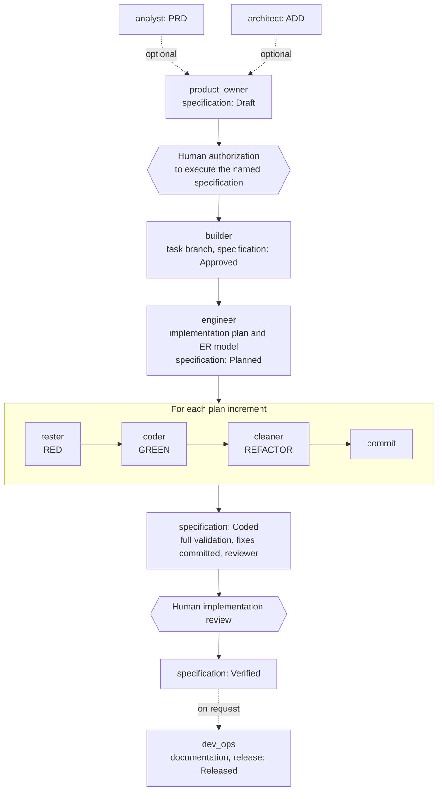
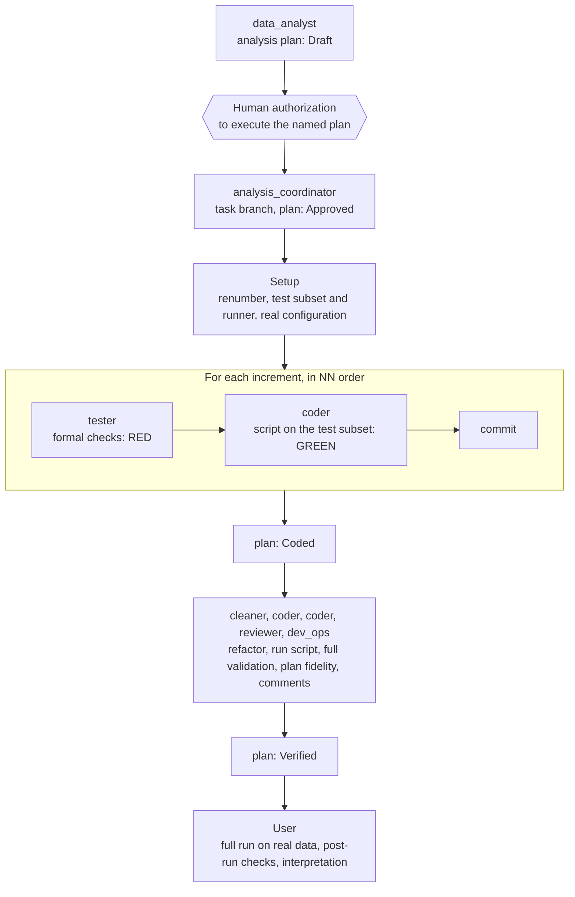

# AI_agents

Agent definitions for programming with AI, usable from Codex and Claude Code.

## Contents

- `.agents/`: shared skills (`skills/`), the workflow catalog (`CODEX.md`), the `AGENTS.md` template
  and reference sources.
- `.codex/`: Codex configuration and the 13 custom agents (`agents/*.toml`), which are the source
  of truth.
- `.claude/`: Claude Code settings, the agents generated from `.codex/agents`, and
  `scripts/generate_agents.py`. `.claude/skills` is a symbolic link to `.agents/skills`.

This first version is kept in one piece. It includes Nextflow, Groovy and nf-core profiles and
skills (`coding-spec`, `linting`, `planning-specs`, `generating-specs`, `testing-unit`,
`nfcore-component-reuse`, `importing-nf-core`), and the analysis workflow (`data_analyst`,
`analysis_coordinator`, the analysis plan template and the `analysis.md` profiles), plus general R,
R Markdown, Python and Bash coding guidelines usable by any workflow. Language and framework
profiles live in each skill's `references/` folder; remove the ones a target project does not
need.

## Workflows

The agents support two workflows: one for programming and one for data analysis. They share the
implementation agents (`tester`, `coder`, `cleaner`, `reviewer`, `dev_ops`) and the same rules:

- A person approves the exact document, a specification or an analysis plan, before any code is
  written. Agents never infer approval.
- A coordinator runs as the main session, owns one task branch and commits only green work. It
  never pushes, merges or tags unless asked.
- Work advances in small increments, each with a failing test first (RED), then the code that
  makes it pass (GREEN).
- Every document has one file that is revised in place, and its status records where the work
  stands.
- When a delegate finds an ambiguity, missing data or a blocking review finding, the coordinator
  stops and reports it instead of guessing.

### Programming workflow



- **Documents in layers**:
  - The PRD (product) and the ADD (architecture) are optional and describe the whole project.
  - Each work item has one specification with testable acceptance criteria in EARS format.
  - `engineer` turns it into one implementation plan of ordered increments, each with the
    phases and agents that execute it, plus an ER model when persistent data change.
- **Status flow**: `Draft` → `Approved` → `Planned` → `Coded` → `Verified` → `Released`. Each
  transition belongs to one agent, and none can be skipped. `builder` records `Approved` in an
  approval commit, and later commits must leave the specification otherwise unchanged.
- **Increments**: `builder` runs the phases the plan declares, one after another, and commits
  each increment only when its tests pass. In Nextflow projects, existing nf-core modules are
  imported with nf-core tools instead of being rewritten.
- **Closing**: at `Coded`, a full validation, with any fixes committed, and an independent
  read-only review against the specification and the plan. A blocking finding stops the cycle
  until a person decides. `Verified` is set only when the user approves the implementation
  review.

### Analysis workflow



- **The plan is the single source of analytical decisions**: it holds the inputs, methodology,
  expected outputs, formal acceptance criteria, test subset rule and the image of each
  increment, by its ID in the project's container image registry. Paths come from the Analysis
  layout in the project's `AGENTS.md`. The coding and testing conventions come from the
  `analysis.md` profiles.
- **Methodology**: `data_analyst` can search the
  [ToolUniverse](https://github.com/mims-harvard/ToolUniverse) catalog to improve the definition
  of the methodology, when the project declares `ToolUniverse_CLI` in `AGENTS.md`; see its
  repository for installation.
- **Agents never touch real data**:
  - They run every script on a deterministic test subset, inside its increment's container
    image.
  - The same code runs on the test and real data, through two configuration files.
  - The user runs the full analysis. Its outputs go to folders versioned by plan version
    (`vN`).
- **Tests check form, not results**: they check the files, formats, columns, row counts
  relative to an input, provenance files, report sections and reproducibility. They never check
  statistics or other values.
- **Steps that cannot run on a subset** are `post-run` increments. They are checked only after
  the user's full run.
- **Revisions**:
  - A change reopens the plan at `Draft`, with change markers, and needs a new approval.
  - A new version renumbers the increments and reruns everything into empty folders.
- **Agents never interpret results or draft conclusions**; reports state only what each table
  or figure shows.

## Install in a project

```bash
./install.sh /path/to/target-repository            # install, or update an installed project
./install.sh --dry-run /path/to/target-repository  # only show what would change
```

The script installs only committed files: it stops if `.agents`, `.claude` or `.codex` have
uncommitted changes in this repository. It copies the three folders as they are, including
`.claude/agents`, and links `.claude/skills` to `.agents/skills`. When the project already has a
`.claude/skills` folder, it links each missing skill inside it instead, leaves the project's own
skills alone, and removes the links of skills that no longer exist. It records every installed
file and its hash in `.agents/.install-manifest.json`, so running it again updates the project:

- The target must be a Git repository with no uncommitted changes in `.agents`, `.claude` or
  `.codex`, so every change can be reviewed with `git diff` and reverted with `git checkout`.
- Files changed here and untouched in the target are updated. Files removed here, for example
  after a skill reorganization, are deleted.
- Files changed in both places are overwritten and listed as conflicts; restore the project's
  version with `git checkout -- <file>` if needed. Files changed or deleted only in the target
  are kept as they are.
- Files the manifest does not list, such as the project's own skills, are never touched.
  `.claude/settings.json` and `.codex/config.toml` are installed only when absent.
- `.agents/VERSION` holds the semantic version of these definitions and is always overwritten,
  even when the target changed it. The summary shows the source and installed versions with
  their commit hashes, for example `Source version: 0.9.0 (68f6dfc)`, and warns when the version
  being installed is lower than the installed one. `.agents/CHANGELOG.md` lists the changes of
  each version and the upgrade notes for installed projects; it is not the project's own
  changelog.
- It shows a summary and asks before changing anything; `--yes` skips that confirmation.
- A project installed by an older version of the script has no manifest. Every file that differs
  is then overwritten as a conflict, and old files no longer in this repository are listed but
  not deleted.

Then, in the target repository:

1. Generate `AGENTS.md`, the briefing and the changelog with the `project-bootstrap` skill
   (template in `.agents/skills/project-bootstrap/AGENTS.template.md`).
2. Add a `CLAUDE.md` that imports it with `@AGENTS.md`, plus the Claude Code notes: agent names use
   hyphens (`product_owner` is `product-owner`), skills are shared through `.claude/skills`, and the
   model equivalence between Codex and Claude Code. Run user-facing roles as the main session
   with `claude --agent <name>`; this includes `data-analyst` and `analysis-coordinator`.
3. Create `agents_data/specs/` and `agents_data/plans/`, where the lifecycle artifacts are stored.
   For the analysis workflow, also define the `Analysis_*` folders (tests go in their own
   `Analysis_Tests_Folder`), the Analysis layout keys and the container execution rules in
   `AGENTS.md`, and ignore the rendered reports, results, figures, test subsets and test run
   outputs (`<Analysis_Tests_Folder>/*/results/` with the default layout).

## Update

Change agents in `.codex/agents`, then regenerate the Claude Code copies:

```bash
python3 .claude/scripts/generate_agents.py
```

## Model equivalence

| Codex | Claude Code |
| --- | --- |
| `gpt-6-sol` | `claude-opus-5-5` |
| `gpt-5.6-terra` | `claude-sonnet-5-5` |
| `gpt-6-luna` | `claude-haiku-5-5` |

The generator maps each Codex model through `MODELS` unless the agent has an entry in
`CLAUDE_MODELS`, a per-agent Claude override keyed by the hyphenated name. The current overrides
run `coder`, `tester` and `cleaner` on `claude-sonnet-5-5` in Claude Code; their Codex models and
every effort level are unchanged.
