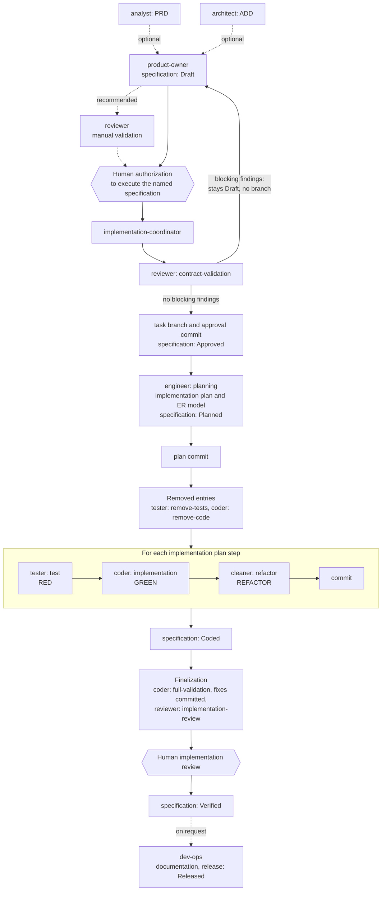

# Programming workflow

How a specification becomes committed, reviewed code. The rules common to both workflows are in
the [README](../README.md#workflows); the phases are defined in
[`.agents/references/phases/`](../.agents/references/phases/).

## Sequence

1. Optionally, `analyst` writes the project's PRD and `architect` its ADD. Both describe the
   whole project.
2. `product-owner` writes one specification per work item, with testable acceptance criteria in
   EARS format, and leaves it at `Draft`.
3. Recommended: the user validates it by running `reviewer` as the main session, and revises it
   with `product-owner` until no blocking finding remains.
4. The user explicitly authorizes `implementation-coordinator` to execute the named
   specification. The coordinator delegates `reviewer: contract-validation` on the current
   branch. With blocking findings, the specification stays at `Draft`, no branch is created, and
   the findings go back to the user. Without them, the coordinator creates the task branch with
   start-task and commits the approval, `docs(<spec-slug-id>): approve specification`.
5. `engineer: planning` writes the single implementation plan with planning-specs, and an ER
   model with data-modeling when persistent data change. The coordinator commits them,
   `docs(<spec-slug-id>): plan specification`.
6. The coordinator runs the phases that the plan declares, in plan order: the Removed entries,
   then each step, then Finalization, committing each one when it is green.
7. When every phase before Finalization is complete, the specification is `Coded`. Finalization
   runs a full validation and an independent implementation review.
8. The user reviews the implementation. On the user's approval, the specification is
   `Verified`.
9. On request, `dev-ops` documents code or releases a version, which sets `Released`.

## Documents

- The PRD (`{Project_Folder}/PRD.md`) and the ADD (`{Project_Folder}/ADD.md`) are optional and
  describe the product and its architecture.
- The specification, `{Specs_Folder}/<spec-slug-id>.spec.md`, holds the product decisions of one
  work item and its acceptance criteria.
- The implementation plan, `{Plans_Folder}/<spec-slug-id>.plan.md`, holds only engineering
  decisions: the test data, the component design, the mapping of each acceptance criterion to
  exactly one step, the ordered steps with their phase markers, the Removed entries, Finalization,
  and the Blockers that the coordinator records. Its header records the approval commit it was
  planned from.
- The ER model, from data-modeling, exists only when persistent data change.
- The reference implementation of a Nextflow component goes in `{Nextflow_Reference_Folder}`:
  versioned scripts in `scripts/` and generated, untracked data in `results/`.

## Phases

The implementation plan names each phase as a checkbox marker, `<agent>: <phase>`; the markers
are the only progress record. For every delegation, the coordinator uses agent-delegation: it
sends the contract and plan paths, what the phase acts on, the phase's entry pasted verbatim from
the phase reference, with the rules for every phase of specification plans and, for a step with
reference outputs or a validation fix in a plan with such a step, the Nextflow rules of that
phase, and the earlier evidence the entry uses. It requires back the evidence that the entry
lists. testing-unit runs every nf-test with `--ci`, never `--update-snapshot`; only a step with
reference outputs has snapshots, derived from them, and the nf-tests of other steps use explicit
assertions.

Nextflow planning depends on each specification, not on the project. A specification that
changes no Nextflow code is planned like any other. One that changes only wiring, channels,
configuration, parameters, or the internals of existing components gets the default phases,
without a component search or a reference implementation. One that needs new processing also
gets a search of local and nf-core components for that processing, with nfcore-component-reuse,
and a reference implementation for each new component that requires reference outputs.

| Section | Phases | Purpose |
| --- | --- | --- |
| Removed | `tester: remove-tests`, `coder: remove-code` | Remove the tests and code of a removed step or criterion. |
| Steps | `tester: test`, `coder: implementation`, `cleaner: refactor` | Default: RED, GREEN, and REFACTOR of one step. |
| Steps | `coder: direct-implementation` | A step that no test can observe, such as configuration or scaffolding; the plan says why. |
| Steps, Nextflow | `coder: import-nf-core` | Import an existing nf-core module or subworkflow with nf-core tools instead of rewriting it, at the plan's pinned SHA. Imported components are never linted or edited: an error traced to one stops the workflow, and the user decides how to resolve it. |
| Steps, Nextflow | `tester: reference-validation`, `coder: reference-generation` | Before the default phases of a new component: validations of independently generated reference outputs, in RED, then the reference outputs until GREEN. |
| Finalization | `coder: full-validation`, `reviewer: implementation-review` | Run the complete suite and lint every changed file except imported nf-core components, without fixing; then review read-only against the specification and the plan. |

Delegations that are not plan markers:

- `reviewer: contract-validation`, before the approval commit;
- `engineer: planning`, after the approval commit, and `engineer: replanning`, when
  implementation evidence shows that the plan must change;
- `<agent>: validation-fix`, when the `full-validation` report shows a failure, to the agent
  responsible for the failing file. Then `coder: full-validation` runs again.

A failed phase is retried a few times by the agent responsible for the failure, as
[agent-delegation](../.agents/skills/agent-delegation/SKILL.md#failure-routing) details. A stop
that it does not route is never retried: the coordinator records it in the plan's Blockers and
reports it to the user.

The coordinator commits each Removed entry, each step, and each Finalization phase with its
markers, and the plan after each replanning, `docs(<spec-slug-id>): replan specification`. It
never pushes, merges, or tags.

## Status ownership

| Transition | Owner | When |
| --- | --- | --- |
| new → `Draft` | `product-owner` | The specification is written. |
| `Draft` → `Approved` | `implementation-coordinator` | After the user's authorization and a contract validation without blocking findings, in the approval commit. |
| `Approved` → `Planned` | `engineer` | After planning; the coordinator commits it with the plan. |
| `Planned` → `Coded` | `implementation-coordinator` | Every phase before Finalization is complete. |
| `Coded` → `Verified` | `implementation-coordinator` | The user approves the implementation review. |
| `Verified` → `Released` | `dev-ops` | During a requested release that includes the specification. |
| any → `Draft` | `product-owner` | A revision after an approval. |

`reviewer` never changes a status. No transition can be skipped, and every commit after the
approval must leave the specification unchanged except for `Status`. At `Coded` without the
user's approval, a resumed coordinator first runs the phases before Finalization that a
replanning left pending, keeping `Coded`, then the pending Finalization phases, and repeats
`coder: full-validation` and `reviewer: implementation-review` only when a phase before them was
pending. A coordinator
authorized on a `Verified` or `Released` specification does nothing and reports its status.

## Revisions

- A change after an approval reopens the specification at `Draft`, through `product-owner`, and
  needs a new authorization, validation, and approval commit.
- `engineer` replans from the diff since the approval commit recorded in the plan: it resets the
  markers of the affected steps and of Finalization, appends new steps without reusing removed
  step numbers, and adds a Removed entry for each removed step or criterion whose tests and code
  must go. Removed entries run before the steps.
- A plan change needed by implementation evidence, with no specification change, also goes
  through `engineer: replanning`.
